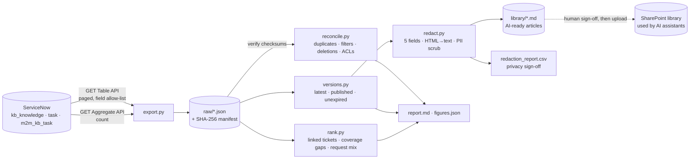

# ServiceNow Knowledge → AI-Ready Library

**A read-only pipeline that turns a ServiceNow knowledge base into a clean, privacy-safe document set for
AI assistants (for example a SharePoint library used by Copilot or Claude). It also shows which articles,
and which gaps, matter most.**

> **Provenance.** This is a portfolio reference implementation of work I did as a Senior Systems Specialist,
> preparing ServiceNow knowledge for a single trusted AI knowledge library. **No employer data, code or
> article content is included.** The pipeline runs against a built-in **fictional mock ServiceNow instance**
> (`kbprep/mock_instance.py`). Its numbers are synthetic and are not the figures from that project.

## What it does

| Step | Module | Result on the mock instance |
|---|---|---|
| 1. **Export** read-only (GET only) through the Table API, saving each table unchanged with a SHA-256 checksum | `export.py` | 3 tables, checksums in `raw/manifest.json` |
| 2. **Reconcile** Table API rows with Aggregate API counts, ruling out duplicates, filters and deletions | `reconcile.py` | 18-row and 39-row gaps traced to row-level ACLs |
| 3. **Versions**: keep one current, published, unexpired version per article | `versions.py` | 260 rows → 136 current articles (124 dropped, each with a reason) |
| 4. **Minimise**: 5 fields only (number, title, category, body, last updated) | `redact.py` | Authors, sys_ids, workflow data never leave |
| 5. **Redact** emails, phones, IPs, internal links and personal names, with a per-article report for sign-off | `redact.py` | 309 redactions across 117 articles |
| 6. **Rank** articles by linked tickets; find high-volume groups with low article coverage; analyse the request mix | `rank.py` | Top request type = 61.9% of all service requests |
| 7. **Publish** one Markdown file per article with front matter, plus `report.md` and `figures.json` | `__main__.py` | `out/library/*.md` |

Every number in `report.md` is rebuilt from the checksummed raw files, and nothing comes from a live query. Anyone can re-derive it.

## Architecture



## Quick start

```bash
python3 -m kbprep run --out out               # fictional mock instance, no credentials
python3 -m unittest discover -s tests -v       # 14 tests
```

```text
Exported 260 article rows -> 136 current articles (124 dropped). Redactions: 309.
  kb_knowledge: 260 rows vs 278 counted -> 18 rows counted by the Aggregate API are not readable through the Tabl
  task: 9000 rows vs 9000 counted -> complete: Table API rows equal Aggregate API count
  m2m_kb_task: 661 rows vs 700 counted -> 39 rows counted by the Aggregate API are not readable through the Tabl
Top request 'Local admin rights (temporary)' = 61.9% of requests. Report: out/report.md
```

Against a real instance (read-only integration user, OAuth token):

```bash
export SN_TOKEN=...
python3 -m kbprep run --out out --instance <instance> --internal-domain corp.example --internal-domain service-now.com
```

## Outputs

| File | Purpose |
|---|---|
| `raw/*.json`, `raw/manifest.json` | Unmodified exports and their SHA-256 hashes |
| `library/KB*.md` | One AI-ready article per file: YAML front matter (4 fields) + redacted body |
| `redaction_report.csv` | Per-article redaction counts by type, with blank reviewer/approved columns for sign-off |
| `redaction_log.csv` | Every redaction: article, type, hash of the original value (never the value) |
| `dropped_versions.csv` | Every excluded version and why |
| `article_ranking.csv` | Linked tickets per article, all time and last 12 months |
| `demand_groups.csv` | Tickets by category, CI and catalog item, with article coverage |
| `figures.json`, `report.md` | All figures with provenance |

## Documentation

- [Architecture and design decisions](docs/architecture.md)
- [Count reconciliation method](docs/reconciliation.md)
- [Privacy rules](docs/privacy-rules.md)
- [Ranking and opportunity analysis](docs/ranking-method.md)
- [Runbook](docs/runbook.md)

## Skills shown

ServiceNow Table and Aggregate APIs · knowledge management · data reconciliation and quality analysis · PII redaction and data minimisation · audit-ready, checksummed reporting · demand analysis for self-service · AI knowledge-source preparation · Python (standard library only) · test automation
