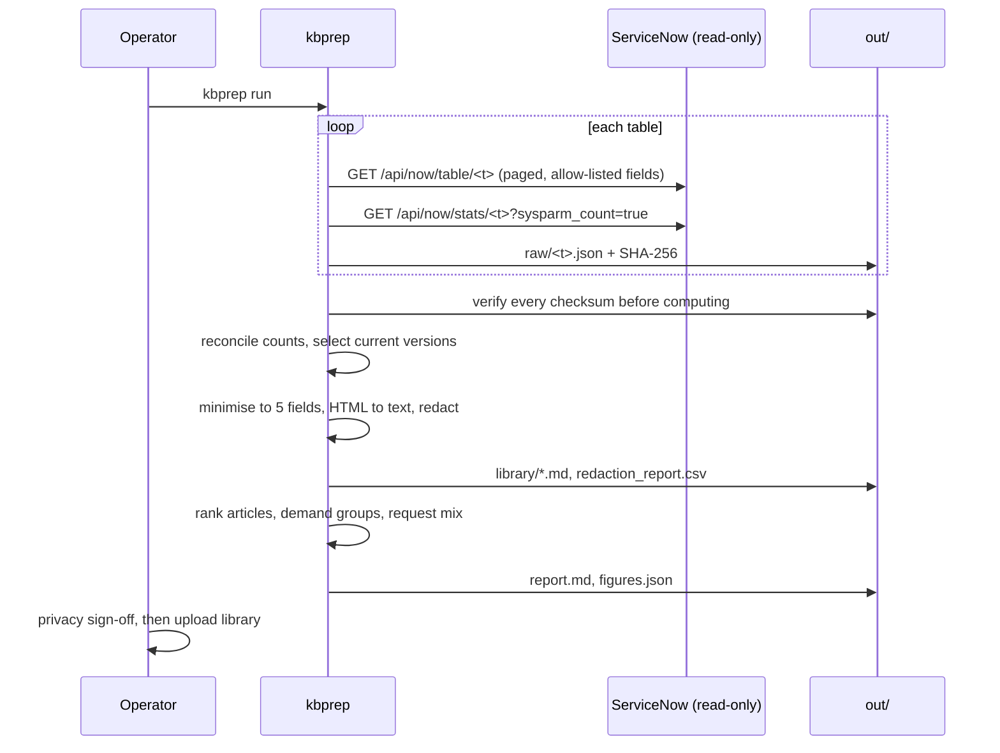

# Architecture and Design Decisions

## Goal

Give AI assistants and employees **one trusted knowledge source**. An AI assistant grounded in a knowledge base is
only as good as that base: old versions produce contradictory answers, and personal data in articles becomes
personal data in answers. The pipeline's job is to make sure the library contains only current content and no
personal data, and to show where better content would have the most impact.

## Stages

## Design decisions

| Decision | Why |
|---|---|
| **Read-only, GET only** (a test enforces it) | A preparation pipeline must never change the system of record |
| **Raw first, compute second** | Figures come from checksummed files, so every number is reproducible and a changed file is detected |
| **Two counts per table** | The Table API silently omits rows the caller can't read; the Aggregate API still counts them. Comparing the two is the cheapest completeness check there is |
| **Hypothesis log for gaps** | "The numbers don't match" becomes "duplicates ruled out, filters ruled out, deletions ruled out, ACLs explain N rows", which a reviewer can check |
| **Exactly one current version per article** (hard error otherwise) | Two live versions of the same article give an AI assistant two answers |
| **Five published fields** | Anything not needed for answering (author, sys_id, workflow, approvers) is personal or internal metadata |
| **Hash, not value, in the redaction log** | The log proves what was removed without becoming a second copy of the PII |
| **Public vendor links kept** | Links to vendor documentation are useful and non-sensitive; only internal hosts are removed |
| **Standard library only** | Runs on a locked-down workstation without package installs |
| **Mock instance in the repo** | The whole pipeline, including the ACL gap, can be demonstrated and tested with no access to any real instance |

## Where AI fits

This repository prepares the source. Retrieval and answering happen in the AI platform that indexes the library. The
redaction pass is deterministic on purpose: privacy rules that must be signed off should behave the same way every run,
not depend on a model's judgement. In the original workflow, Claude Code with a ServiceNow MCP server did the read-only
export interactively, and this pipeline is the scripted, repeatable equivalent.
